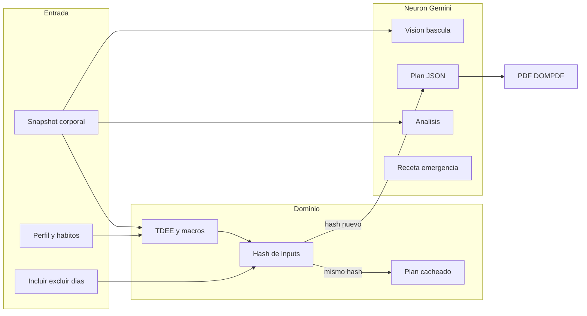

# Roadmap NutriSave

Documento de producto y de entrega. **No es una guía de implementación en curso:** el código de cada fase se hace después, en una rama y un PR según el desglose de abajo.

El repo es un esqueleto Laravel 12 (onion, Livewire 4, Neuron AI, DOMPDF, Horizon, PostgreSQL). Aún no hay auth, perfil, hogares ni dominio de dietas.

## Fuera de alcance (v1)

- Lista de la compra del hogar
- Presupuesto
- Chat libre de la home
- Pagos, app nativa, Bluetooth de básculas, recetario completo, wearables, RAG de Neuron

Se podrán retomar cuando existan el PDF de dietas y el seguimiento.

## Decisiones de producto

- **Hogar compartido:** mismos alimentos en el plan, calorías distintas por persona. Un PDF de hogar con cantidades por columna/persona. Sin lista de compra.
- **Alimentos:** el usuario indica qué usar y qué excluir; Gemini usa eso como contexto y **puede proponer extras**. Alergia = veto duro; disgusto = evitar. No hay catálogo global en v1 (los alimentos inventados viven en el JSON del plan).
- **IA de desarrollo:** Google Gemini (tier gratuito de [AI Studio](https://aistudio.google.com/apikey)). Neuron ya tiene driver `gemini`. Modelo: `gemini-2.5-flash` (visión + JSON estructurado + español). No usar `gemini-3-pro-preview` ni OpenAI de pago en esta fase. Fallback local: Ollama.
- **TDEE en PHP**, no en el LLM (Mifflin-St Jeor + actividad). El perfil debe incluir **sexo** y **objetivo** (perder / mantener / ganar).
- **Determinismo:** caché por `input_hash` (snapshots, TDEE, includes/excludes, duración, días, objetivo). Mismo hash → mismo JSON + PDF, **sin llamar a Gemini**.
- **PDF desde plantilla Blade + DOMPDF**, nunca generado por la IA.
- **Auth:** Fortify + Livewire 4, sin Jetstream.
- Un usuario, un hogar en v1. Invitación por email. Disclaimer: no es consejo médico.
- **Identidad:** PKs `bigint` como `users.id`. Las asigna Postgres al insertar. Domain solo envuelve el id (`UserId`, `HouseholdId`); no genera UUID ni el siguiente entero. Un agregado nuevo puede ir sin id hasta el `save`.

## Cómo partir ramas y PRs

Convención: `feat/<fase>-<nn>-<slug>` desde `develop`. Un PR, un tema. Merge a `develop`en orden (no stacked PRs). Objetivo de revisión: pocos archivos de un mismo tipo, no “dominio + migración + Livewire + agente + PDF” juntos.

Reglas:

- Dominio (contratos, VOs, tests unitarios) en un PR; persistencia (migración, Eloquent, repo) en el siguiente; UI Livewire después.
- Agentes Neuron con **fakes** en tests; no llamadas reales a Gemini en CI.
- Si un PR se acerca a ~15 archivos o mezcla capas, partirlo.
- Cada PR incluye tests del trozo que toca y nada de scope extra.

Ningún paquete nuevo, migración, agente ni pantalla hasta que se abra la primera rama `feat/0-01-fortify-backend`.

## Desglose por fase (rama → PR)

### Fase 0 — Auth y cáscara

- `feat/0-01-fortify-backend` — paquete Fortify, provider, config. Sin vistas custom.
- `feat/0-02-auth-livewire` — login, registro, reset (Livewire + Blade).
- `feat/0-03-dashboard-shell` — layout autenticado, middleware, quitar demo de `Home` / chat de muestra. Dashboard vacío.

### Fase 1 — Hogar, perfil, snapshots manuales

- `feat/1-01-household-domain` — contratos y VOs de hogar / miembro.
- `feat/1-02-household-persistence` — migraciones `households`, `household_members` (`id` bigint), repos Eloquent. `save` inserta y devuelve el agregado con el id de Postgres.
- `feat/1-03-household-ui` — crear hogar, invitar por email, aceptar invitación.
- `feat/1-04-profile-domain` — perfil, sexo, objetivo, hábitos, TDEE (solo fórmulas + tests).
- `feat/1-05-profile-persistence` — migraciones `profiles`, `body_snapshots`.
- `feat/1-06-profile-ui` — formulario obligatorio; bloquear “generar dieta” si falta.
- `feat/1-07-snapshot-ui` — registro manual de peso y composición.
- `feat/1-08-snapshot-cadence` — cadencia 7/14/30 y aviso de snapshot caducado (scheduler).

### Fase 2 — Visión de báscula

- `feat/2-01-ai-port-structured` — ampliar `AiAgent` con `structured` (sin imágenes aún) + adapter Neuron y tests con fake.
- `feat/2-02-gemini-dev-config` — `.env.example` / README: `NEURON_AI_PROVIDER=gemini`, `GEMINI_MODEL=gemini-2.5-flash`.
- `feat/2-03-ai-port-vision` — `interpretImages` + `ImageContent` en Infrastructure.
- `feat/2-04-scale-agent-job` — `ScaleReadingAgent`, DTO nullable, job Horizon.
- `feat/2-05-scale-ui` — subida de fotos, pre-relleno, confirmación del usuario.

### Fase 3 — Preferencias y ventana del plan (sin presupuesto)

- `feat/3-01-preferences-persistence` — includes de **hogar**, excludes de **persona** (`allergy` | `dislike`).
- `feat/3-02-preferences-ui` — formulario incluir / excluir.
- `feat/3-03-plan-window-ui` — duración (semanal, bisemanal, N días) y días (p. ej. L–V). Validar snapshot vigente por miembro.

### Fase 4 — Generación determinista y PDF

- `feat/4-01-diet-plan-persistence` — `diet_plans` + `diet_plan_servings`, índice único `input_hash` por hogar.
- `feat/4-02-diet-plan-agent` — DTO structured (día → comida → alimento + gramos **por miembro**). Sin lista de compra ni presupuesto en el schema.
- `feat/4-03-generate-use-case` — hash, caché, job. Si el hash existe, no llamar a Gemini.
- `feat/4-04-diet-pdf` — vista Blade A4 (tabla por día, columnas por persona) + `DomPdfGenerator`.
- `feat/4-05-generate-ui` — botón generar, estado cola, descarga / re-descarga.

### Fase 5 — Análisis tras registro

- `feat/5-01-progress-persistence` — `progress_analyses`.
- `feat/5-02-progress-agent` — comparación con snapshot anterior, recomendaciones JSON.
- `feat/5-03-progress-ui` — evolución + disparo al guardar snapshot. “Nueva dieta” solo cuando el usuario genera (hash nuevo).

### Fase 6 — Comida de emergencia

- `feat/6-01-emergency-persistence` — ingredientes + receta JSON, caché por hash de ingredientes.
- `feat/6-02-emergency-agent` — receta (aquí sí) con raciones por miembro.
- `feat/6-03-emergency-ui` — flujo aparte; no reescribe el plan semanal.

## Después (no entra en v1)

- Lista de la compra agregada del hogar
- Presupuesto semanal como guía para Gemini
- Descarga PDF individual por miembro (si se echa en falta)

## Modelo de datos (v1, sin compra ni presupuesto)

- **households**, **household_members** (owner / member). PKs y FKs `bigint`, igual que `users`.
- **profiles**: sexo, fecha de nacimiento, altura, actividad, deportes, objetivo, cadencia
- **body_snapshots**: peso, IMC calculado, % opcionales, origen `manual | scale_ai`, fotos
- **food_preferences**: include hogar; exclude persona
- **diet_plans**: `household_id`, `input_hash`, días, JSON, path PDF, estado
- **diet_plan_servings**: día / comida / alimento / miembro
- **progress_analyses**, **emergency_meals**

## Pendiente: tablas del esqueleto (revisar y decidir)

Laravel y Neuron crean tablas que **hoy no usa NutriSave** con Redis (`SESSION_DRIVER`, `CACHE_STORE`, `QUEUE_CONNECTION`). No son dominio; son inercia del starter. Dejarlas hasta tener el PDF de dietas y el seguimiento; entonces decidir si se quedan (fallback de driver / features de Neuron) o se eliminan con una migración `drop`.

| Tabla | Origen | Uso actual | Criterio |
| --- | --- | --- | --- |
| `sessions` | Laravel | Vacía (sesiones en Redis) | ¿Compromiso permanente con Redis? Si sí, se puede dropear. |
| `cache`, `cache_locks` | Laravel | Vacías (caché en Redis) | Igual. La caché de planes v1 será `diet_plans.input_hash`, no esta tabla. |
| `jobs`, `job_batches` | Laravel | Vacías (cola en Redis + Horizon) | Igual. `failed_jobs` **sí se usa**: no tocarla. |
| `chat_messages` | Neuron | Vacía; chat libre fuera de v1 | ¿Algún agente usará historial Eloquent de Neuron? Si no, dropear y dejar de cargar `database/migrations/neuron`. |
| `workflow_store` | Neuron | Vacía | ¿Workflows persistidos de Neuron, o solo jobs + `diet_plans`? Si lo segundo, dropear. |

`users`, `password_reset_tokens` y `failed_jobs` se quedan. No mezclar este recorte con un PR de dominio o UI.

## Anexo: correo (de cara a futuro)

Fortify (reset de contraseña) e `feat/1-03-household-ui` (invitar por email) usan el mailer de Laravel. **No hay fase ni PR de “montar un servidor de correo”.**

- **Local / v1 de desarrollo:** `MAIL_MAILER=log` (`.env.example`). El mensaje no sale a internet; queda en `storage/logs/laravel.log` (asunto, cuerpo, enlace de aceptar).
- **Tests:** `MAIL_MAILER=array` (`phpunit.xml`) + `Notification::fake()`. Nada de SMTP en CI.
- **Producción / staging (cuando alguien deba recibir el mail de verdad):** no un SMTP propio. Un proveedor (Resend, Amazon SES, Postmark, Mailgun o SMTP del host) y `MAIL_FROM_ADDRESS` de un dominio verificado. Solo cambiar `.env`; no mezclar con un PR de dominio o UI.
- **Opcional en local:** Mailpit/Mailhog en el puerto `2525` del `.env.example` para ver el HTML. No es requisito de ninguna fase.
